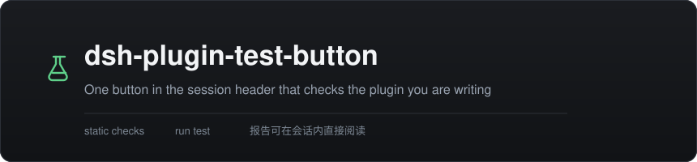

<div align="center">



[](LICENSE)
&nbsp;
&nbsp;
&nbsp;

English | [中文说明](README.zh-CN.md)

</div>

## Why we built this

We write Harness plugins, and the loop around each change was slow: edit `client.js`, install the bundle,
look at the session header to see whether the button showed up, click it, then read the session log to
find out what actually happened. Every round cost a few minutes and a lot of clicking.

So we put a smaller loop in the header itself. One button, one command, one report. It checks the plugin
that is currently in the session's working directory and prints what it found, inside the conversation
you are already looking at.

## What it does

Click **Test plugin** in the session header. The button runs the `/plugin-test` command. The command does
not call the model, and it does not touch your draft.

The report has two parts.

**Static checks**

- `package.json` parses, has `name` and `version`, and sets `"type": "module"`.
- `dsh.bundle` or `dsh.client` is declared.
- Every entry in `files` resolves to a real file (`locale/*.json` patterns are expanded).
- `dsh.bundle.patch` exists and names the package; the patch file's config row id is printed.
- `exports["./client"]` points at a file that exists, and `dsh.client.platform` is `web`.
- `node --check` passes on the host entry and, when present, on the client entry.
- The package is actually installed and its client bundle has a route (`clientModules.clientPath`). A
  package that is only on disk gets `未安装或 UI bundle 未注册` instead of a passing line.
- The icon is at most 256 KiB, and each `locale/*.json` carries `meta.title`.

**Run test** (only when every static check passed)

- An isolated `node` subprocess imports the host entry and calls `apply(mockCtx, {})`. The mock context is
  a Proxy that records what the plugin registers, so the report lists the real calls, for example
  `commands.register（plugin-test）` or `tools.register`. Timeout is 8 seconds.
- The client half is parsed as text: each `.slots.register({ name, id, order })` call is printed, for
  example `conversation.session.header.actions（id=plugin-test-button, order=0）`.

A plugin that exports a service class instead of `apply` is reported as a warning, not as a run.

## What it does not do

The run test proves the plugin loads and registers something. It does not render the UI, so it cannot
tell you whether the button looks right. For client changes, refresh the page and look. For host changes,
restart Harness: the host module is not hot-reloaded, and an old module will keep answering the command
with old text. We hit that ourselves, twice.

## See it work

```text
🧪 插件自检 · D:\plugins\demo
扫描范围：默认：会话工作区本身 + 直接子目录（depth 1）；可用工作区根的 .dsh-plugin-test.json 声明 roots/depth/exclude

📦 @local/my-plugin @ 0.1.0 · demo
  ✅ files 声明的 6 项全部存在
  ✅ bundle patch 正常（配置行 id=my-plugin）
  ✅ 客户端入口 ./client.js 存在（platform=web）
  ✅ JS 语法检查通过（./index.js, ./client.js）
  ✅ 已安装 · UI bundle 可加载（/plugins/@local/my-plugin/client.js）
  ✅ 图标正常（484 字节）

▶️ 运行测试 · @local/my-plugin
  ✅ Host 入口在独立进程中执行成功（./index.js）
  ✅ 捕获注册：commands ×1
    · commands.register（my-command）
  ✅ UI 注册槽位：conversation.session.header.actions（id=my-button, order=0）

结论：✅ 必检项全部通过
提示：UI 类插件请刷新页面后肉眼确认槽位效果；Host 类插件改动后需要重启 Harness。
```

Failed checks read the same way, with the file that failed:

```text
  ❌ files 中声明的文件不存在：locale/ja.json
  ❌ syntax error → ./index.js → index.js:12
结论：❌ 有 2 项必须修复
```

## Install

Copy this directory anywhere on disk, then let the plugin manager link it:

```text
plugin_manager install_bundle  target = D:\path\to\dsh-plugin-test-button
```

The plugin manager writes the profile's `package.json` and `cordis.patch.yml` for you. Do not edit those
files by hand and do not run `pnpm` inside the profile directory.

After install, the header shows the button in 创造模式 sessions. If your Harness predates the preset
projection this plugin reads, the button stays hidden; see [Visibility](#visibility).

Uninstall: remove `@local/dsh-plugin-test-button` in the plugin panel, or use
`plugin_manager remove_bundle`.

## Use

1. Open a session in 创造模式, with the plugin you are writing somewhere inside the session's working
   directory.
2. Click **Test plugin**.
3. Read the report. Fix the `❌` lines first. `⚠️` lines are things a human should look at.
4. For a client half change, refresh the page. For a host half change, restart Harness.

## Configuration

Optional. Put `.dsh-plugin-test.json` at the workspace root to change what gets scanned:

```json
{
  "roots": ["plugins", "D:\\work\\second-plugin"],
  "depth": 3,
  "exclude": ["old-experiments", "node_modules"]
}
```

- `roots`: directories to scan. Relative paths resolve against the session working directory. Default is
  the working directory itself.
- `depth`: how deep to look below each root, 0 to 6. Default is 1, which covers the working directory and
  its direct children only. That default exists because scanning deeper picks up unrelated plugins.
- `exclude`: directory names to skip.

Skip lists that are always on: `node_modules`, `.git`, `dist`, `build`, `out`, `coverage`, `.cache`,
`.turbo`, and any directory that starts with a dot. The scan stops at 6 plugin packages and visits at most
4 levels.

If the file is missing or malformed, the report says so on the 扫描范围 line and falls back to the
default.

## Visibility

The button renders only when the session's agent preset is `cordis`, which is 创造模式. The client reads
the `agentPreset` session projection (initialised from the session header, updated by
`agent-preset/selected`), and falls back to scanning the session event stream. If neither yields a preset
after about 3 seconds, the button renders nothing: a hidden button is easier to explain than a button that
appears everywhere.

## How it works

| File | Role |
| --- | --- |
| `index.js` | Host half. Registers the `plugin-test` command, scans, checks, and returns the report as command text. |
| `probe.mjs` | Standalone runner. `node probe.mjs <plugin dir> <output json>` imports a plugin's host entry, calls `apply` with a recording mock context, and writes the result as JSON. The host half runs it in a child process so a crash cannot take Harness down. |
| `client.js` | Web half. Registers the header slot entry and calls `session.command('/plugin-test')`. Falls back to setting the draft and submitting when the session binding is not ready. |
| `cordis.patch.yml` | Loader patch that inserts this package into the profile. |
| `locale/zh.json`, `locale/en.json` | Plugin panel title and description. |

Slots and services used: slot `conversation.session.header.actions`; host services `commands`,
`workingDirectory`, `clientModules`; client services `sessions` (read through `ctx.get` so the plugin still
loads if the service is absent).

## Development

```text
node --check index.js client.js probe.mjs
node probe.mjs . out.json          # run the probe against a plugin directory
node .dev/selftest.mjs             # offline run against a fake ctx (not shipped)
```

Client changes need a page refresh. Host changes need a Harness restart. Both are worth remembering before
you conclude the plugin is broken.

## License

MIT.
